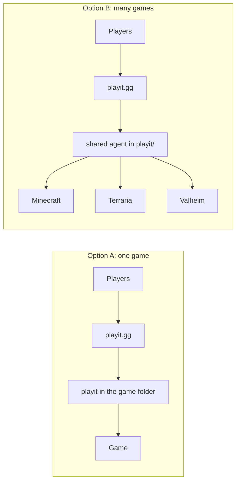

# Game Server Stack

Self-hosted game servers for a school community, running in Docker on one Linux server.
Players join from anywhere through **playit.gg**, so no router port forwarding is needed.

Every game folder is self-contained: copy just the one you need.

## Servers

| Game | Folder | Image | Host port |
| --- | --- | --- | --- |
| Minecraft (NeoForge 1.21.1) | `minecraft/` | `itzg/minecraft-server:java21` | 25566/tcp |
| Terraria + mods (tModLoader) | `terraria-modded/` | `jacobsmile/tmodloader1.4` | 7777/tcp |
| Terraria vanilla 1.4.5 | `terraria-vanilla/` | `ryshe/terraria:vanilla-1.4.5.5` | 7779/tcp |
| Valheim (crossplay) | `valheim/` | `lloesche/valheim-server` | 2456–2458/udp |

## Two ways to use playit.gg



**Option A — one game, one agent.** Easiest if you only host one server.

```bash
cd minecraft
cp .env.example .env        # fill in passwords + PLAYIT_SECRET_KEY
docker compose --profile playit up -d
```

**Option B — many games, one shared agent.** What I run on my server: less to manage, one playit account view.

```bash
cd playit && cp .env.example .env && docker compose up -d
cd ../minecraft && cp .env.example .env && docker compose up -d   # no --profile
```

Either way, the agent uses the host network, so each tunnel on the playit.gg dashboard points to `127.0.0.1:<host port>`.
Use a TCP tunnel for Minecraft and Terraria, and a UDP tunnel for Valheim.

> Valheim with `-crossplay` can also be joined with an in-game join code, without any tunnel.

## Layout

```
<game>/
├── docker-compose.yml   # the server (+ optional playit service)
├── .env.example         # copy to .env, never commit .env
└── data/                # world + server files, created on first start (git-ignored)
```

## Seasons & backups

<!-- TODO: how a new season is started, how worlds are backed up and restored -->

## Problems I ran into

<!-- TODO: real issues and how they were fixed (memory limits, mod versions, an empty server password, lag, crashes...) -->
